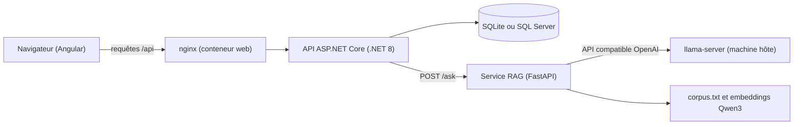

# Assistant RAG en architecture d'entreprise

Ce dépôt est un projet de démonstration qui intègre un assistant RAG local, écrit en Python, dans une architecture applicative classique : une interface Angular de type chat, une API ASP.NET Core (.NET 8) qui stocke l'historique dans une base SQL, et un petit service FastAPI qui expose le RAG. L'assistant répond uniquement à partir d'un fichier texte (ici, une présentation du Viêt Nam) et l'interface affiche, sous chaque réponse, les passages du document qui ont servi à la produire. Le modèle de langage tourne en local avec llama.cpp, sans aucun service cloud.

## Architecture



Le navigateur n'appelle que le serveur nginx du conteneur web, qui sert l'application Angular et redirige les requêtes `/api` vers l'API .NET. L'API valide la question, la transmet au service RAG, enregistre la question, la réponse et les passages dans la base (SQLite par défaut, SQL Server en option), puis renvoie le résultat. Le service RAG découpe le corpus en passages de 120 mots, calcule leurs embeddings avec Qwen3-Embedding-0.6B, retrouve les cinq passages les plus proches de la question et interroge un modèle Qwen3.5-9B servi par llama-server. Ce dernier tourne sur la machine hôte et non dans Docker.

## Structure du dépôt

Le dossier `rag-service` contient le service FastAPI (`app.py`), qui enveloppe le pipeline RAG existant (`pipeline.py` et `outils_systeme.py`, repris sans modification), ainsi que le corpus. Le dossier `api` contient la solution .NET, avec le projet `RagApi` (contrôleurs, client HTTP du service RAG, accès à la base) et le projet `RagApi.Tests`. Le dossier `web` contient l'application Angular et la configuration nginx. Le dossier `evaluation` contient les deux jeux de questions, le script `evaluate.py` et les rapports générés. À la racine se trouvent le fichier `docker-compose.yml`, sa variante pour SQL Server et le modèle de fichier d'environnement.

## Lancer avec Docker

Il faut Docker Desktop et un llama-server démarré sur la machine hôte, par exemple :
Le modèle utilisé ici, Qwen3.5-9B au format GGUF, a été choisis sur hugging face

```powershell
./llama-server -m Qwen3.5-9B-UD-Q4_K_XL.gguf -c 8192 -t 8 --port 8080
```

Depuis la racine du dépôt, la commande suivante construit et démarre les trois services :

```powershell
docker compose up --build
```

L'interface est alors disponible sur http://localhost:8081. Le premier démarrage est long : le service RAG télécharge le modèle d'embedding (plus d'un gigaoctet, conservé ensuite dans un volume Docker) et calcule les embeddings du corpus. La commande `docker compose ps` indique quand le service RAG est prêt. Si ce service n'arrive pas à joindre llama-server depuis son conteneur, relancer llama-server avec l'option `--host 0.0.0.0` règle le problème, en sachant que le modèle devient alors accessible depuis le réseau local.

Pour utiliser SQL Server à la place de SQLite, il faut créer le fichier d'environnement (en changeant le mot de passe, car ce fichier n'est pas versionné) puis ajouter le fichier de surcharge :

```powershell
Copy-Item .env.example .env
docker compose -f docker-compose.yml -f docker-compose.sqlserver.yml up --build
```

La commande `docker compose down` arrête les services en conservant les données, et `docker compose down -v` supprime aussi les volumes.

## Lancer en développement

Quatre terminaux sont nécessaires : llama-server comme ci-dessus, puis les trois commandes suivantes, chacune dans son dossier.

```powershell
cd rag-service
pip install -r requirements.txt
uvicorn app:app --port 8000
```

```powershell
cd api\RagApi
dotnet run --urls http://localhost:5000
```

```powershell
cd web
npm install
ng serve --proxy-config proxy.conf.json
```

L'interface est alors sur http://localhost:4200, et la documentation interactive de l'API sur http://localhost:5000/swagger.

## Tests

La commande `dotnet test`, lancée depuis le dossier `api`, exécute 24 tests. Ils comprennent des tests unitaires du client HTTP du service RAG (réponse valide, erreur 500, service injoignable, JSON invalide, délai dépassé, annulation), des tests du service d'historique sur une vraie base SQLite en mémoire, et des tests d'intégration qui démarrent l'API complète avec un faux client RAG pour vérifier les codes 200, 400, 503 et 204. Ils n'ont besoin ni du modèle de langage ni du service Python. Si l'API tourne en parallèle, il faut l'arrêter avant, car Windows verrouille son exécutable.

## Évaluation du RAG

Deux jeux de questions interrogent directement le service RAG. Le premier compte vingt questions factuelles, le second huit questions plus exigeantes (calcul à partir de deux faits, synthèse, reformulations, listes complètes). Le script classe chaque erreur selon sa cause : récupération (le passage utile n'a pas été fourni au modèle), génération (le passage était présent mais la réponse est fausse) ou service.

```powershell
cd evaluation
python evaluate.py
python evaluate.py --questions questions_difficiles.json --output difficile
```

Le premier jeu donne 20 réponses correctes sur 20 et le second 8 sur 8, avec un temps de réponse moyen d'environ 100 secondes par question sur processeur. Le passage utile était présent dans les passages récupérés pour 20 questions sur 20, puis 8 sur 8. L'écart du second jeu correspond à la question de calcul, dont la réponse (trente ans) n'est écrite nulle part dans le texte : il s'agit d'une limite de la mesure, qui cherche la réponse attendue dans les passages, et non d'une erreur de récupération. Les rapports complets, avec le tableau des erreurs (vide pour l'instant), sont dans `evaluation/report.md` et `evaluation/difficile/report.md`.

## Choix techniques

L'API ne dépend que d'une interface (`IRagClient`), ce qui permet de la tester sans le service Python, et traduit toute panne du RAG en erreur 503 que l'interface sait afficher. L'historique est enregistré avec Entity Framework Core et le fournisseur est choisi par configuration (SQLite par défaut, SQL Server en option). Les passages sont stockés en JSON dans la même ligne que l'échange, afin de conserver exactement ce qui a été montré à l'utilisateur. L'interface Angular utilise des composants autonomes et des signaux, appelle des adresses relatives et passe par un proxy (celui du serveur de développement, puis nginx en conteneur) plutôt que par CORS. Les sorties du modèle sont affichées par interpolation, qui échappe le HTML. Les outils du pipeline qui écrivent des fichiers ou exécutent des commandes sont systématiquement refusés dans le service, faute d'utilisateur pour les valider. Les images Docker utilisent des constructions en plusieurs étapes et leurs processus tournent sans droits administrateur.

## Limites

Le modèle tourne sur le processeur dans la configuration de développement : une réponse prend environ 100 secondes, sans affichage progressif. Le délai maximal est de 300 secondes côté API, et nginx est réglé à 330 secondes pour pouvoir transmettre une éventuelle erreur. Chaque question est traitée indépendamment : l'historique est un journal, pas une mémoire de conversation. Le service RAG traite une seule question à la fois.

Le corpus est minuscule (une cinquantaine de lignes, une dizaine de passages) et la recherche est une comparaison exhaustive en Python, sans base vectorielle : le comportement sur des documents volumineux n'a pas été évalué. Comme cinq passages sur une dizaine sont récupérés, l'indicateur de présence du passage utile est peu discriminant. L'évaluation compte 28 questions, jugées par présence de mots-clés (ce qui peut rejeter une bonne réponse reformulée), et ne contient aucune question hors corpus : la capacité à reconnaître qu'une information est absente n'est pas mesurée, d'autant que le pipeline peut interroger Wikipédia. Un score de 28 sur 28 montre que la chaîne fonctionne de bout en bout, pas que le système généralise. Enfin, les passages sont extraits du message texte du pipeline par une expression régulière, un couplage fragile.

Le schéma de la base est créé avec `EnsureCreated`, sans migrations : il ne peut pas évoluer sur une base existante. L'option SQL Server est fournie mais n'est couverte par aucun test automatisé, et aucun test de contrat ne vérifie que le service Python respecte le format attendu par l'API. L'API n'a ni authentification ni HTTPS, Swagger y est activé sans condition d'environnement, et il n'y a pas de nouvelle tentative automatique en cas d'échec. Le modèle de langage n'est pas conteneurisé : le fichier Compose suppose un llama-server déjà lancé sur l'hôte. Le corpus est intégré à l'image du service RAG, donc toute modification du texte demande une reconstruction.